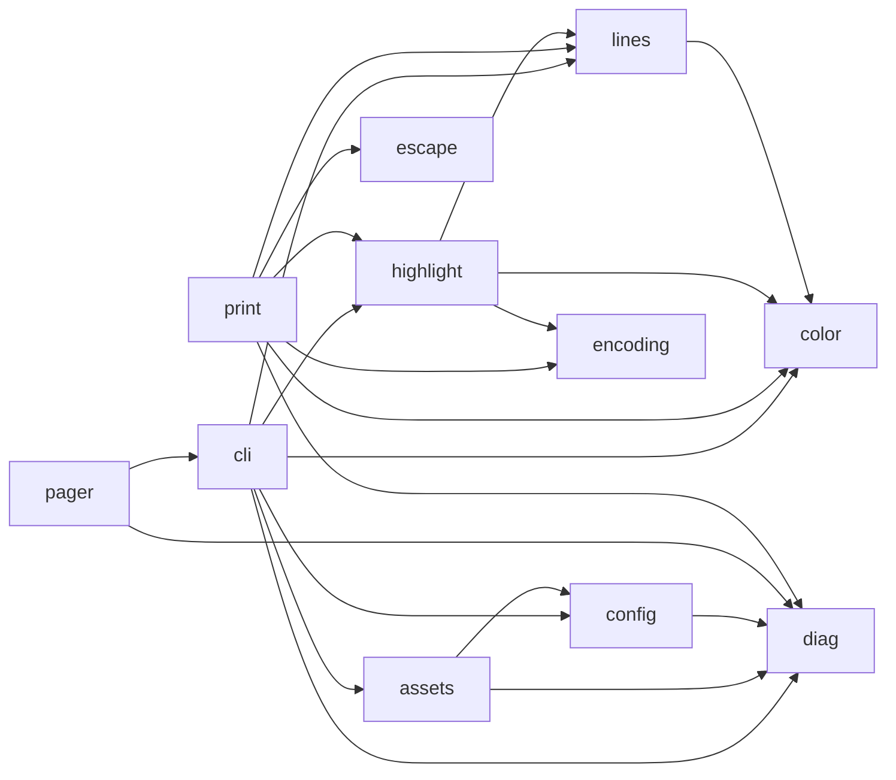
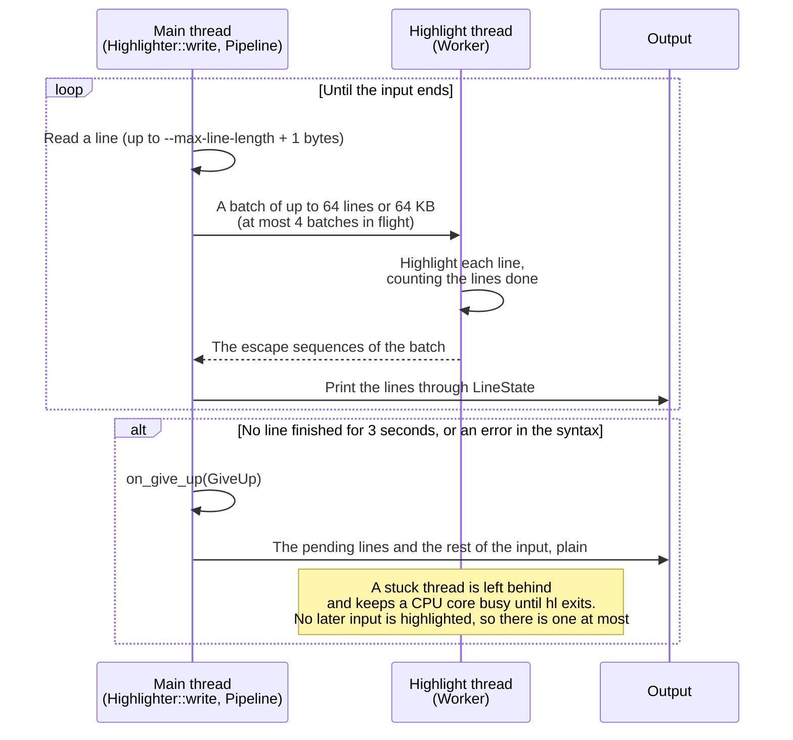
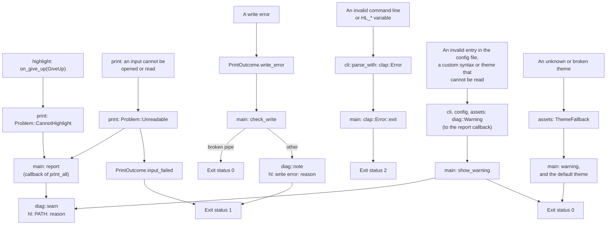

# hl design

[English](DESIGN.md) | [日本語](DESIGN_ja.md) · [README](../README.md)

This document describes how the code of `hl` is organized and why. What `hl` does is described in [SPEC.md](SPEC.md), and how to build, test and release it in [DEV.md](DEV.md).

## Overview

`hl` is a single binary crate. `src/main.rs` reads the settings, picks where the output goes, and hands the inputs to `print::print_all`, which prints each of them highlighted or plain.

Most of the work is done once per run before the first input: the syntaxes and the theme are loaded, the `--map-syntax` mappings are resolved, and a `Printer` is built. `print_all` then only reads, decides and writes.

## Modules

| File | Role |
| --- | --- |
| `src/main.rs` | Entry point: runs the commands that print no inputs (`--list-themes`, ...), builds the printer and the line state from the arguments and config, picks the pager or stdout, handles errors and the exit code. Decides what the problems found on the way become: an unknown language in `--map-syntax` is an error and one in the config file a warning (`resolve_mappings` turns each `UserMapping` into the pattern and the `Syntax` that the highlighter gets), an unknown or broken theme falls back to the default with a warning, and a problem with an input from `src/print.rs` gets a warning. The only module that writes to stderr: the warnings the other modules find come to it as values (`diag::Warning` through a `report` callback, `ThemeFallback`, the broken themes of `Themes::names`). The only place that reads the environment (the `HL_*` variables, `PAGER`, `LESS`, the color depth) and the command line. Resolves the config and cache directories and `HL_CONFIG` once (`config::Dirs::from_env`) and passes them to the config file and `src/assets.rs`. The only place that exits on a usage error: `cli::parse_with` returns the `clap::Error`, and main calls `exit` on it (status 2) |
| `src/assets.rs` | The default theme, the bundled syntaxes, custom syntaxes and themes from the config directory, merged with the bundled ones, and the syntax cache (`--build-cache`/`--clear-cache`). Takes the directories as arguments, so it reads no environment variables. Writes no warnings: a file that cannot be read goes to a `report` callback as a `diag::Warning`, a theme that cannot be used comes back from `Themes::get` (`ThemeFallback`) and `Themes::names` |
| `src/cli.rs` | Command-line argument definitions (clap) and the config file applied to them (option defaults, flags, `map-syntax`). `--map-syntax` and `map-syntax` entries are parsed into a `UserMapping`: the pattern for `src/highlight.rs` (`SyntaxMapping`), the language and the entry as written, and where it comes from (`Origin`: the command line or the config file at a path). The rest of the code reads the arguments through methods that combine related options (`numbering()`, `visibility()`, `limits()`, ...), not through the raw fields. A bad entry in the config file is ignored and goes to a `report` callback, not to stderr. The `HL_*` variables come from a `getenv` function main passes, not from clap, and become option defaults below the command line. An invalid command line or variable is returned as a `clap::Error` instead of ending the process. The commands that print something other than the inputs (`--list-themes`, `--man`, ...) form one clap group, so at most one of them is given |
| `src/color.rs` | Terminal color depth detection, the 256-color fallback, and the escape sequences for colors, bold and reset |
| `src/config.rs` | Config file loading (the file named by `HL_CONFIG`, else the one in the config directory) and the config/cache directories (`Dirs`, from `XDG_CONFIG_HOME`/`XDG_CACHE_HOME`, `APPDATA`/`LOCALAPPDATA` on Windows, and `HOME`; it holds the `HL_CONFIG` file too). A config file that cannot be read goes to a `report` callback, not to stderr |
| `src/diag.rs` | Warning and error messages on stderr. Everything written to stderr goes through it, so the `hl: ` format is set in one place; an error is shown with its causes (`path: reason`). `Warning` is how the other modules hand a warning to `src/main.rs`, the only caller of `note` and `warn` |
| `src/encoding.rs` | UTF-8/UTF-16 BOM detection and UTF-16 decoding |
| `src/escape.rs` | Removing the escape sequences of the input (CSI, OSC and the other strings, C1 controls in UTF-8) and the C0 controls that act on the terminal (BEL, BS, SO, ...) as a reader, also when a sequence is split across reads |
| `src/highlight.rs` | Language detection, the `--map-syntax` patterns (`SyntaxMapping`, matched against the file name, or the absolute path that `detect` finds once per input; it does not know where the mapping comes from), size limits, and highlighted output (syntect, on a thread of its own with a time limit). A language is a `Syntax`: a syntax with the `Arc` of its syntax set. Writes no warnings: the reason highlighting was given up goes to the caller |
| `src/highlight/worker.rs` | The highlighting thread of one input (`Worker`) and the pipeline that hands it lines in batches, prints what comes back and gives up when no line finishes in time (`Pipeline`) |
| `src/lines.rs` | Line numbering, blank-line squeezing, and `cat -v`/`-E`/`-T` notation |
| `src/pager.rs` | Building the pager command from `$PAGER` and `$LESS`, which `src/main.rs` reads into a `PagerEnv`, and from `--paging` (`PagingWhen`: with `auto`, a bare `less` also gets `-F`). `$PAGER` is split like the shell, or by Windows rules on Windows. Also starts the pager and waits for it to exit. A missing default `less` is reported apart from other failures, so that `src/main.rs` can print to stdout instead |
| `src/print.rs` | Printing each input in turn, highlighted or plain, with headers and encoding handling. Writes no warnings: problems with an input (unreadable, highlighting given up) go to a callback, and `print_all` returns a `PrintOutcome` (whether an input failed, the write error that ended the output) |
| `src/stdout.rs` | Telling whether stdout was closed at startup, before std reopens it on `/dev/null` (Unix), or whether there is a stdout handle at all (Windows), and turning on escape sequence processing in the Windows console, so that colors work in cmd.exe and PowerShell outside Windows Terminal. The only module with `unsafe` code (see [the development notes](DEV.md)) |
| `src/test_support.rs` | Helpers for the unit tests only: a reader that returns its input in chunks of the given sizes, a proptest strategy for those sizes, a syntax that makes syntect loop forever (`LOOPING_SYNTAX`), and a syntax built from YAML (`custom_syntax`) |
| `build.rs` | Fixes the JavaScript and Scala syntaxes of two-face and bundles the syntaxes |

## Module dependencies

The arrows show which module uses which (`use crate::...`, not counting the tests). `src/main.rs` uses all of them and is left out. `highlight` includes its submodule `highlight::worker`.

There are no cycles. `color`, `diag`, `encoding`, `escape` and `stdout` depend on no other module of `hl`, and `highlight` and `lines` do not depend on `diag`. Only `main` writes to stderr: the other modules use `diag` only for `Warning` and the functions that format a message (`describe`, `escape_controls`, `display_safe`).

## Printing an input

`Printer::print` (`src/print.rs`) decides how one input is printed, following the second diagram in [Behavior details](SPEC.md#behavior-details):

1. When there is nothing to highlight and the escape sequences are kept, the input goes straight to `lines::write_plain`, which copies it like `cat`. This is the path of every run without colors, as when the output is a pipe. So does every run with `-v`, `-E` or `-T`, which `Printer::print` checks itself rather than relying on `Args::use_color` having turned colors off. A file over `--max-size`, and every input after one that got stuck (`Highlighter::has_stalled`), have nothing to highlight either.
2. Otherwise the first 8 KB (`PEEK_LEN`) are read in full. A pipe can return a few bytes per read, so deciding from the first read alone would give different output for the same bytes from a file and from a pipe.
3. From those bytes `encoding::utf16_bom` finds a UTF-16 BOM, and a NUL byte or invalid UTF-8 makes the input binary. The syntax is chosen from the path and the first line (`Printer::choose_syntax`, `Highlighter::detect`).
4. The bytes already read are put back in front of the rest of the input (`Cursor::chain`), so nothing is lost. UTF-16 is decoded by `encoding::Utf16Decoder`, and the escape sequences are removed by `escape::StripEscapes` when asked. Both are readers, so the input is never held in memory as a whole.
5. The result goes to `Highlighter::write`, or to `write_plain`.

`lines::LineState` carries line numbering, squeezing of blank lines and `--line-range` across the inputs, and both the highlighted and the plain path print each line through it.

## Highlighting pipeline

syntect can loop forever on some syntaxes and inputs, and a call into it cannot be interrupted. So `Highlighter::write` (`src/highlight.rs`) reads and prints the lines on the main thread, and highlights them on a thread of its own (`src/highlight/worker.rs`):

- Lines are handed over in batches (`BATCH_LINES`, `BATCH_BYTES`) because handing over each line costs more than highlighting it. `MAX_IN_FLIGHT` bounds how far the reading runs ahead, and so the memory used.
- The main thread waits for a batch with `recv_timeout`, ten times per `STALL_TIMEOUT` (3 seconds), and compares the count of lines done each time. Highlighting is given up only when no line has finished for the whole timeout, so a big batch of slow but progressing lines is not cut short.
- A stall sets the `stalled` flag of the `Highlighter` (in `Pipeline::give_up`, on `GiveUp::Stalled` only), and `Printer::print` highlights no input once it is set. Without it, each input that trips the same syntax would wait another 3 seconds and leave one more thread spinning. An error in the syntax does not set it: the thread ends, and the next input is highlighted as usual. The reason goes to `on_give_up` as a `GiveUp`, so that `main.rs` can say in the warning that the later inputs are plain too.
- The thread gets the syntax as a `highlight::Syntax`, which holds an `Arc` of its syntax set and its index in the set, and the theme through an `Arc`, because a stuck thread outlives the input it was started for. The thread highlights with the syntax set of that `Syntax`, so a syntax is never used with a set it does not belong to.
- syntect's state carries over from line to line, so highlighting cannot resume after a line that was not highlighted. A line over `--max-line-length`, an input over `--max-size`, a line that is not UTF-8, an error in the syntax and a stuck line all switch the rest of the input to plain output.
- Lines that are not printed (before the range, squeezed) are still highlighted, so that the printed ones get the same colors. Reading stops at the end of the range.

## Problems, messages and exit status

All output on stderr goes through `src/diag.rs`, so the `hl: ` prefix and the escaping of control characters (`diag::escape_controls`, `diag::display_safe`, and `diag::warn`, which escapes the path and the message, as it may quote a key or a value of the config file) are done in one place, and a failure to write stderr is ignored. Only `src/main.rs` calls `diag::note` and `diag::warn`. The other modules do not write messages themselves: they return what went wrong or pass it to a callback, and `src/main.rs` decides what it becomes. `print_all` passes a `print::Problem` to its `report` callback; `cli::parse_with`, `Config::load`, `assets::syntaxes`, `assets::build_cache`, `Themes::load` and `main::resolve_mappings` pass a `diag::Warning` (the path and the message, or a note without a path) to theirs, which `main::show_warning` shows. This keeps the order of the messages, and lets the unit tests check what they say.

`print::TrackedWriter` remembers whether writing failed, so that an error coming out of `print_all` can be told apart from an error reading an input: after a write error there is no point in reading more inputs, while after a read error the next input is printed.

## Design rules

- **The environment is read at startup only.** `config::Dirs::from_env` (the directories and `HL_CONFIG`), the command line and the `HL_*` variables passed to `cli::parse_with` (`env::args_os`, and `env::var_os` as its `getenv`), `color::detect_from_env`, and `PAGER` and `LESS` in `main.rs` are all read in `main.rs` before printing starts. Everything else takes the values as arguments, so the tests can give any environment, and the developer's own environment does not leak into them (`cli::parse_with` with a `getenv` of the test's own, `Dirs::from_getenv`). clap is not left to read the `HL_*` variables because it reads them from the process when it builds the arguments, so a test could not give its own; the `Command` that has them is used only to show `--help`.
- **Plain output is `cat`'s output.** Without colors, and with the escape sequences kept, the bytes are copied as they are. No byte is replaced, not even invalid UTF-8 (the input goes through `String::from_utf8_lossy` only to detect the syntax from the first line). This is what makes `alias cat=hl` safe.
- **Modules return problems instead of printing them.** `highlight` and `print` pass the reason to a callback or return it in `PrintOutcome`, and `cli`, `config` and `assets` pass a `diag::Warning` to a callback or return why a theme cannot be used; `main.rs` decides whether it is a warning or an error, and is the only module that writes to stderr. For example, an unknown language in `--map-syntax` is an error, and in the configuration file a warning (`cli::Origin`).
- **The arguments are read through methods.** The rest of the code does not read the raw fields of `cli::Args` but methods that combine related options, such as `numbering()`, `visibility()`, `limits()`, `use_color()` and `strip_escapes()`, so that a rule such as "`-b` overrides `-n`" or "`-v` turns off colors" is written once.
- **Only what is needed is loaded.** The syntaxes are loaded only when the output is colored or a language is named (`Args::needs_syntaxes`), and the theme only when the output is highlighted. A plain run, such as into a pipe, with no language named loads neither.
- **The bundled syntaxes are fixed at build time.** `build.rs` patches the JavaScript and Scala syntaxes of two-face and writes the syntax set that `assets::bundled_syntaxes` embeds. If an update of two-face changes them so that a fix no longer applies, `build.rs` fails the build with the name of the syntax, instead of silently shipping the hang again (see [DEV.md](DEV.md#dependencies)).
- **The cache of custom syntaxes knows when it is stale.** Its fingerprint (`assets::fingerprint`) holds the version of `hl`, a hash of the bundled syntaxes, and the paths, sizes and modification times of the custom syntaxes. A cache that does not match is not used, and a reminder to run `hl --build-cache` is printed.
- **A closed stdout is detected before `main`.** On Unix, std reopens a closed stdout on `/dev/null` before `main` runs, which would hide the error. `src/stdout.rs` checks fd 1 from a function run by the loader before that, and on Windows asks for the stdout handle (see the module documentation).
