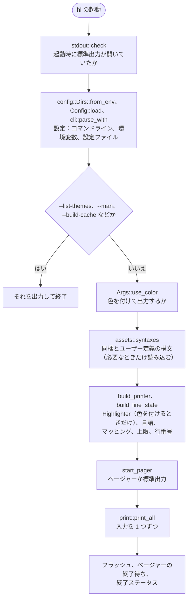
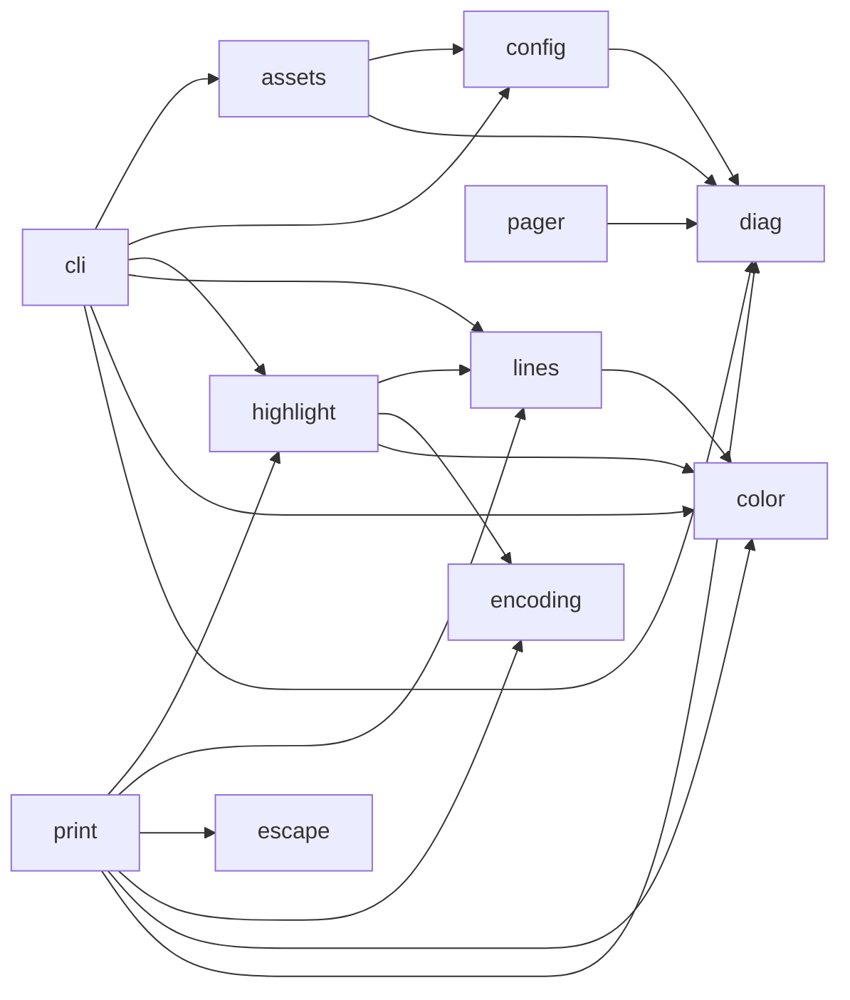
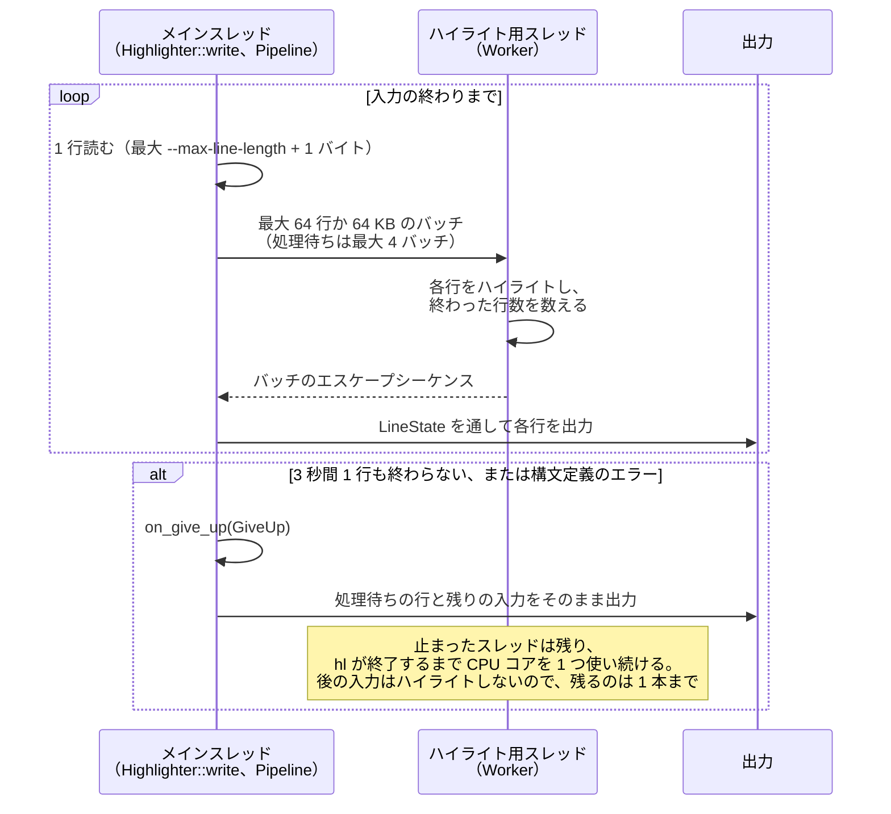
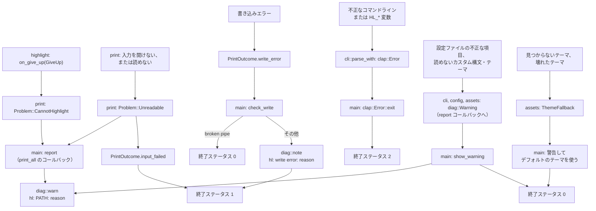

# hl の設計

[English](DESIGN.md) | [日本語](DESIGN_ja.md) · [README](../README_ja.md)

このドキュメントでは、`hl` のコードがどう構成されているか、なぜそうなっているかを説明します。`hl` の動作は [SPEC_ja.md](SPEC_ja.md)、ビルド・テスト・リリースの方法は [DEV_ja.md](DEV_ja.md) を参照してください。

## 全体の流れ

`hl` はバイナリクレート 1 つでできています。`src/main.rs` が設定を読み込んで出力先を決め、入力を `print::print_all` に渡します。`print_all` は入力を 1 つずつ、ハイライトするかそのままで出力します。

処理の大半は、最初の入力より前に 1 回だけ行います。構文とテーマを読み込み、`--map-syntax` のマッピングを解決し、`Printer` を作ります。そのあと `print_all` がするのは、読み込み、判定、書き出しだけです。

## モジュール

| ファイル | 役割 |
| --- | --- |
| `src/main.rs` | エントリポイント。入力を表示しないコマンド（`--list-themes` など）の実行、引数と設定からの Printer と行の状態の組み立て、ページャか標準出力かの選択、エラー処理と終了コード。途中で見つかった問題の扱いもここで決める（`--map-syntax` の未知の言語はエラー、設定ファイルの未知の言語は警告、未知のテーマや壊れたテーマは警告してデフォルトに戻す、`src/print.rs` から届いた入力の問題は警告）。stderr に書くモジュールはここだけで、ほかのモジュールが見つけた警告は値として届く（`report` コールバックに渡される `diag::Warning`、`ThemeFallback`、`Themes::names` が返す壊れたテーマ）。環境変数（`HL_*` 変数、`PAGER`、`LESS`、色深度）とコマンドラインを読むのはここだけ。設定・キャッシュディレクトリと `HL_CONFIG` もここで 1 回だけ求め（`config::Dirs::from_env`）、設定ファイルと `src/assets.rs` に渡す。使い方のエラーでプロセスを終えるのもここだけで、`cli::parse_with` が返した `clap::Error` に対して `exit` を呼ぶ（終了ステータス 2） |
| `src/assets.rs` | デフォルトのテーマ、同梱の構文、設定ディレクトリのカスタム構文・テーマの読み込みと同梱分とのマージ、構文キャッシュ（`--build-cache`/`--clear-cache`）。ディレクトリは引数で受け取り、環境変数は読まない。警告は書かない。読めないファイルは `diag::Warning` として `report` コールバックに渡し、使えないテーマは `Themes::get`（`ThemeFallback`）と `Themes::names` が返す |
| `src/cli.rs` | コマンドライン引数の定義（clap）と、設定ファイルの適用（オプションのデフォルト値、フラグ、`map-syntax`）。ほかのモジュールは生のフィールドではなく、関連するオプションをまとめるメソッド（`numbering()`、`visibility()`、`limits()` など）で引数を読む。設定ファイルの不正な項目は無視し、stderr ではなく `report` コールバックに渡す。`HL_*` 変数は clap ではなく、main が渡す `getenv` 関数から受け取り、コマンドラインの次に優先するデフォルト値にする。不正なコマンドラインや変数は、プロセスを終えずに `clap::Error` として返す。入力の代わりに何かを表示するコマンド（`--list-themes`、`--man` など）は 1 つの clap のグループにまとめてあり、指定できるのは 1 つまで |
| `src/color.rs` | 端末の色深度の判定、256 色へのフォールバック、色・太字・リセットのエスケープシーケンス |
| `src/config.rs` | 設定ファイルの読み込み（`HL_CONFIG` が指すファイル、なければ設定ディレクトリのもの）と、設定・キャッシュディレクトリ（`Dirs`。`XDG_CONFIG_HOME`/`XDG_CACHE_HOME`、Windows では `APPDATA`/`LOCALAPPDATA`、`HOME` から求める。`HL_CONFIG` のファイルも持つ）。読めない設定ファイルは stderr ではなく `report` コールバックに渡す |
| `src/console.rs` | Windows のコンソールでエスケープシーケンスの処理を有効にする（Windows Terminal 以外の cmd.exe や PowerShell でも色が出るようにする） |
| `src/diag.rs` | 標準エラー出力への警告・エラーメッセージ。標準エラー出力にはすべてここを通して書くので、`hl: ` の書式は 1 か所で決まる。エラーは原因まで含めて表示する（`パス: 理由`）。`Warning` は、ほかのモジュールが警告を `src/main.rs` に渡すための型。`note` と `warn` を呼ぶのは `src/main.rs` だけ |
| `src/encoding.rs` | UTF-8/UTF-16 の BOM 判定と UTF-16 のデコード |
| `src/escape.rs` | 入力からエスケープシーケンス（CSI、OSC などの文字列、UTF-8 で表した C1 制御文字）と、端末を操作する C0 制御文字（BEL、BS、SO など）を取り除くリーダー。読み込みの境目で分かれたシーケンスも取り除く |
| `src/highlight.rs` | 言語判定、`--map-syntax` の対応付け、サイズの上限、ハイライト出力（syntect。専用のスレッドで、時間の上限付き）。言語は `Syntax` で表す（構文と、その構文セットの `Arc` の組）。警告は出さず、ハイライトをあきらめた理由は呼び出し側に渡す |
| `src/highlight/worker.rs` | 入力 1 つ分のハイライト用スレッド（`Worker`）と、パイプライン（`Pipeline`）。パイプラインは行をまとめてスレッドに渡し、返ってきた結果を出力し、時間内に終わる行がなければハイライトをあきらめる |
| `src/lines.rs` | 行番号、空行の圧縮、`cat -v`/`-E`/`-T` の表記 |
| `src/pager.rs` | `$PAGER` からのページャのコマンドの組み立て（シェルと同じ規則、Windows では Windows の規則で分ける）、起動、終了待ち。既定の `less` がないことはほかの失敗と分けて返し、`src/main.rs` が代わりに標準出力に表示できるようにする |
| `src/print.rs` | 各入力の順次出力（ハイライトありかなしか）、ヘッダ、文字コードの扱い。警告は出さず、入力の問題（読めない、ハイライトをあきらめた）はコールバックに渡す。`print_all` は `PrintOutcome`（入力の失敗があったか、出力を中断させた書き込みエラー）を返す |
| `src/stdout.rs` | 起動時に標準出力が閉じられていたかの判定（Unix では std が `/dev/null` で開き直す前に確かめ、Windows では標準出力のハンドルがあるかを確かめる） |
| `src/test_support.rs` | 単体テスト専用の補助。入力を指定したサイズずつ返すリーダー、そのサイズを作る proptest の strategy、syntect を無限ループさせる構文（`LOOPING_SYNTAX`）、YAML から構文を作る関数（`custom_syntax`） |
| `build.rs` | two-face の JavaScript 構文と Scala 構文の修正と、構文の同梱 |

## モジュールの依存関係

矢印は、どのモジュールがどのモジュールを使うか（`use crate::...`、テストは除く）を表します。`src/main.rs` はすべてのモジュールを使うので省いています。`highlight` には、そのサブモジュールの `highlight::worker` も含めています。

循環はありません。`color`、`diag`、`encoding`、`escape`、`console`、`stdout` は `hl` の他のモジュールに依存しません。`highlight` と `lines` は `diag` に依存しません。stderr に書くのは `main` だけで、ほかのモジュールが `diag` から使うのは `Warning` と、メッセージを整える関数（`describe`、`escape_controls`、`display_safe`）だけです。

## 入力の出力

1 つの入力をどう出力するかは `Printer::print`（`src/print.rs`）が決めます。流れは [動作の詳細](SPEC_ja.md#動作の詳細) の 2 つ目の図のとおりです。

1. ハイライトせず、エスケープシーケンスも残すときは、入力をそのまま `lines::write_plain` に渡し、`cat` と同じようにコピーします。出力先がパイプのときなど、色を付けない実行はすべてこの経路を通ります。`-v`、`-E`、`-T` を指定した実行も同じです。これは `Args::use_color` が色を止めていることに頼らず、`Printer::print` 自身が確かめます。`--max-size` を超えるファイルと、ハイライトが止まった入力より後の入力（`Highlighter::has_stalled`）も、ハイライトしないのでこの経路です。
2. それ以外のときは、先頭 8 KB（`PEEK_LEN`）を最後まで読みます。パイプは 1 回の読み込みで数バイトしか返さないことがあるので、最初の読み込みだけで判定すると、同じバイト列でもファイルから読んだときとパイプから読んだときで出力が変わってしまいます。
3. 読んだバイト列から、`encoding::utf16_bom` で UTF-16 の BOM を探し、NUL バイトか不正な UTF-8 があればバイナリとみなします。構文はパスと先頭行から選びます（`Printer::choose_syntax`、`Highlighter::detect`）。
4. 読んだバイト列は残りの入力の前に戻す（`Cursor::chain`）ので、何も失われません。UTF-16 は `encoding::Utf16Decoder` でデコードし、指定があれば `escape::StripEscapes` でエスケープシーケンスを取り除きます。どちらもリーダーなので、入力全体をメモリに持つことはありません。
5. その結果を `Highlighter::write` か `write_plain` に渡します。

行番号、空行の圧縮、`--line-range` は `lines::LineState` が入力をまたいで管理し、ハイライトする経路もしない経路も、各行をこれを通して出力します。

## ハイライトのパイプライン

syntect は構文と入力の組み合わせによって無限ループすることがあり、呼び出しを途中で止める方法もありません。そこで `Highlighter::write`（`src/highlight.rs`）は、行の読み込みと出力をメインスレッドで行い、ハイライトは専用のスレッド（`src/highlight/worker.rs`）で行います。

- 行はバッチ（`BATCH_LINES`、`BATCH_BYTES`）にまとめて渡します。1 行ずつ渡すと、受け渡しのほうがハイライトより高くつくからです。`MAX_IN_FLIGHT` で読み込みが先に進みすぎないようにし、メモリの使用量を抑えます。
- メインスレッドは `recv_timeout` でバッチを待ち、`STALL_TIMEOUT`（3 秒）の間に 10 回、終わった行数を確かめます。タイムアウトの間ずっと 1 行も終わらなかったときだけハイライトをあきらめるので、遅くても進んでいる大きなバッチは打ち切りません。
- 止まると `Highlighter` の `stalled` フラグが立ち（`Pipeline::give_up` で、`GiveUp::Stalled` のときだけ）、立ったあとは `Printer::print` がどの入力もハイライトしません。これがないと、同じ構文で止まる入力のたびに 3 秒待ち、回り続けるスレッドが 1 本ずつ増えます。構文定義のエラーではフラグは立ちません。スレッドは終わるので、次の入力は普段どおりハイライトします。理由は `GiveUp` として `on_give_up` に渡すので、`main.rs` は後の入力もプレーンになることを警告に書けます。
- スレッドには、構文を `highlight::Syntax`（構文セットの `Arc` と、セットの中での添字の組）として、テーマを `Arc` として渡します。止まったスレッドは、それを起動した入力より長く生き残るからです。スレッドは渡された `Syntax` の構文セットでハイライトするので、構文が別のセットと組み合わさることはありません。
- syntect の状態は行から行へ引き継がれるので、ハイライトしなかった行のあとから再開することはできません。`--max-line-length` を超える行、`--max-size` を超えた入力、UTF-8 として不正な行、構文定義のエラー、止まった行のどれでも、入力の残りはそのまま出力します。
- 出力しない行（範囲より前の行、圧縮した空行）もハイライトします。出力する行の色を、ファイル全体を表示したときと同じにするためです。読み込みは範囲の終わりで止めます。

## 問題の扱い、メッセージ、終了ステータス

stderr への出力はすべて `src/diag.rs` を通します。`hl: ` の接頭辞と制御文字のエスケープ（`diag::escape_controls`、`diag::display_safe`、それにパスとメッセージの両方をエスケープする `diag::warn`。メッセージには設定ファイルのキーや値が入ることがあるため）を 1 か所で行い、stderr への書き込みの失敗は無視します。`diag::note` と `diag::warn` を呼ぶのは `src/main.rs` だけです。ほかのモジュールは自分ではメッセージを書かず、何が起きたかを返すかコールバックに渡し、それをどう扱うかは `src/main.rs` が決めます。`print_all` は `print::Problem` を `report` コールバックに渡します。`cli::parse_with`、`Config::load`、`assets::syntaxes`、`assets::build_cache`、`Themes::load`、`main::resolve_mappings` は `diag::Warning`（パスとメッセージ、またはパスのない注意書き）を `report` コールバックに渡し、`main::show_warning` がそれを表示します。こうするとメッセージの順序はそのままで、単体テストでメッセージの内容を確かめられます。

`print::TrackedWriter` は書き込みに失敗したかどうかを覚えておき、`print_all` の中で起きたエラーが書き込みのエラーか入力の読み込みのエラーかを区別できるようにします。書き込みのエラーのあとは残りの入力を読んでも意味がありませんが、読み込みのエラーのあとは次の入力を出力します。

## 設計上の決まり

- **環境変数を読むのは起動時だけ。** `config::Dirs::from_env`（ディレクトリと `HL_CONFIG`）、`cli::parse_with` に渡すコマンドラインと `HL_*` 変数（`env::args_os` と、`getenv` として渡す `env::var_os`）、`color::detect_from_env`、`main.rs` の `PAGER` と `LESS` は、どれも出力を始める前に `main.rs` で読みます。それ以外のコードは値を引数で受け取るので、テストでは好きな環境を与えられ、開発者自身の環境がテストに影響しません（テスト用の `getenv` を渡した `cli::parse_with`、`Dirs::from_getenv`）。`HL_*` 変数を clap に読ませないのは、clap が引数を組み立てるときにプロセスの環境変数を読んでしまい、テストから別の値を与えられないためです。変数を持った `Command` は `--help` の表示にだけ使います。
- **色を付けない出力は `cat` の出力と同じ。** 色を付けず、エスケープシーケンスも残すときは、バイト列をそのままコピーします。不正な UTF-8 も含めて、置き換えるバイトはありません（入力を `String::from_utf8_lossy` に通すのは、先頭行から構文を判定するときだけです）。`alias cat=hl` を安全に使えるのはこのためです。
- **モジュールは問題を出力せず、返す。** `highlight` と `print` は理由をコールバックに渡すか `PrintOutcome` で返します。`cli`、`config`、`assets` は `diag::Warning` をコールバックに渡すか、テーマを使えない理由を返します。警告にするかエラーにするかは `main.rs` が決め、stderr に書くのも `main.rs` だけです。たとえば見つからない言語は、`--map-syntax` ならエラー、設定ファイルなら警告です（`highlight::Origin`）。
- **引数はメソッドを通して読む。** `cli::Args` の生のフィールドは読まず、`numbering()`、`visibility()`、`limits()`、`use_color()`、`strip_escapes()` など、関連するオプションをまとめたメソッドを使います。「`-b` は `-n` より優先」「`-v` を指定すると色を付けない」といった決まりを 1 か所に書くためです。
- **必要なものだけ読み込む。** 構文を読み込むのは、色を付けるときか言語を指定したときだけ（`Args::needs_syntaxes`）、テーマはハイライトするときだけです。パイプへの出力など、色を付けず言語も指定しない実行では、どちらも読み込みません。
- **同梱の構文はビルド時に修正する。** `build.rs` が two-face の JavaScript 構文と Scala 構文を修正し、`assets::bundled_syntaxes` が埋め込む構文のセットを書き出します。two-face の更新で修正が当たらなくなったら、`build.rs` は構文の名前を出してビルドを失敗させます。無限ループする構文に気づかないまま出荷しないためです（[DEV_ja.md](DEV_ja.md#依存関係) を参照）。
- **ユーザー定義の構文のキャッシュは、古くなったことに気づける。** キャッシュのフィンガープリント（`assets::fingerprint`）には、`hl` のバージョン、同梱の構文のハッシュ、ユーザー定義の構文のパス・サイズ・更新日時が入っています。一致しないキャッシュは使わず、`hl --build-cache` の実行を促すメッセージを出します。
- **閉じた標準出力は `main` より前に検出する。** Unix では、std が `main` の前に閉じた標準出力を `/dev/null` で開き直すので、そのままではエラーが隠れてしまいます。`src/stdout.rs` は、それより前にローダーが実行する関数で fd 1 を確かめます。Windows では標準出力のハンドルそのものを問い合わせます（詳しくはモジュールのドキュメントを参照）。
