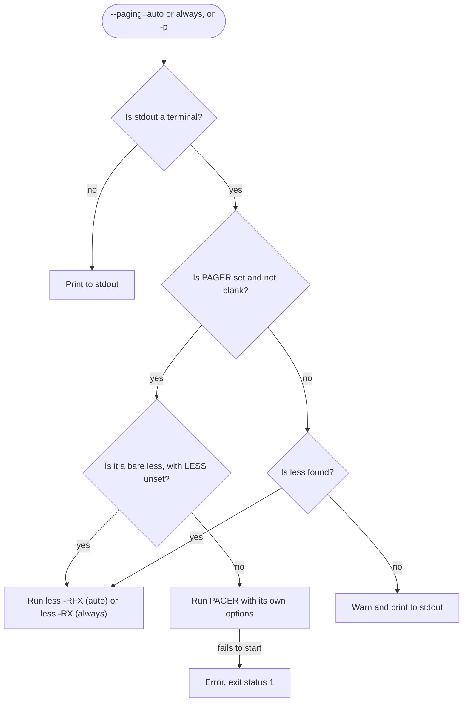
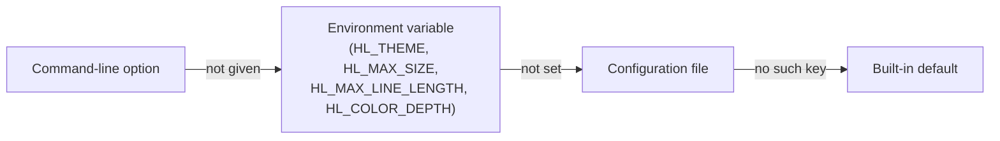
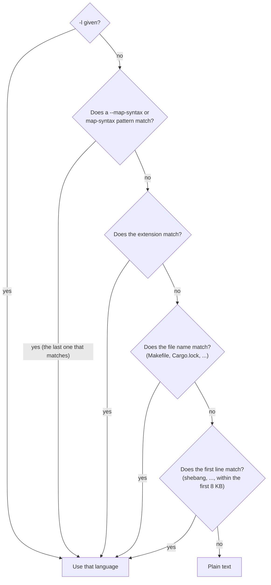
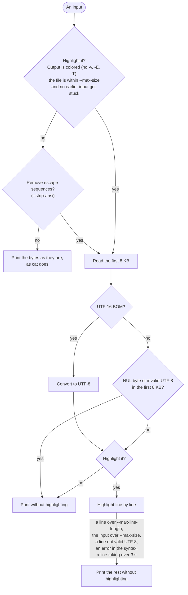

# hl specification

[English](SPEC.md) | [日本語](SPEC_ja.md) · [README](../README.md)

This document describes what `hl` does: its options, environment variables, configuration file, custom syntaxes and themes, and how it treats its input. For installation and a quick start, see the [README](../README.md).

## Options

| Option | Description |
| --- | --- |
| `-n`, `--number` | Number output lines. Like `cat -n`, numbering continues across files |
| `-b`, `--number-nonblank` | Number non-empty output lines. Overrides `-n` |
| `-s`, `--squeeze-blank` | Squeeze repeated empty lines into one |
| `-r`, `--line-range <N:M>` | Print only lines N to M of each input. `N:` runs to the end, `:M` starts at line 1, and `N` prints a single line. Line numbers start at 1 and are written in digits only, so `+3` and ` 3` are rejected |
| `-H`, `--highlight-line <N:M>` | Show lines N to M of each input with the background color of the theme's line highlight. Takes the same forms as `-r` and can be given more than once. The line number from `-n` or `-b` is highlighted too, but not the rest of the line beyond its text. Only applies when the output is colored, so it does not change plain output |
| `--header` | Print a `==> FILE <==` header before each input |
| `--no-number`, `--no-number-nonblank`, `--no-squeeze-blank`, `--no-header` | Turn off `-n`, `-b`, `-s` or `--header` set in the [configuration file](#configuration-file). Of a flag and its `--no-*` option, the one given last wins |
| `-v`, `--show-nonprinting` | Show control characters and bytes 128 and above in `^` and `M-` notation (except newline and tab) |
| `-E`, `--show-ends` | Print `$` at the end of each line |
| `-T`, `--show-tabs` | Print tabs as `^I` |
| `-A`, `--show-all` | Same as `-vET` |
| `-e` | Same as `-vE` |
| `-t` | Same as `-vT` |
| `-u` | Accepted for `cat` compatibility and ignored |
| `-l`, `--language <LANG>` | Use this language instead of auto-detection, given as a name or an extension (e.g. `rust`, `py`) |
| `--map-syntax <PATTERN:LANG>` | Use language LANG for files matching the glob PATTERN (e.g. `'*.conf:INI'`). LANG is a name or an extension, as with `-l`. A pattern without `/` matches the file name; a pattern with `/` matches the absolute path (`*` stays within one directory, `**` spans any number). On Windows, `\` is a separator as well, in the pattern and in the path, so `**\conf\*.cfg:INI`, `**/conf/*.cfg:INI` and `C:/proj/*.cfg:INI` all work. Can be given more than once; when several mappings match, the last one wins. Standard input is never mapped |
| `--theme <THEME>` | Color theme (case-insensitive), bundled or custom. Defaults to `base16-ocean.dark`, which is also used with a warning if the theme is not found |
| `--max-size <SIZE>` | Print inputs larger than this without highlighting. Default `512K`. A whole number of bytes, optionally followed by `K`, `M` or `G` (powers of 1024, either case), such as `1048576` or `1M`; negative numbers and fractions such as `1.5K` are rejected. `0` removes the limit |
| `--max-line-length <LEN>` | Stop highlighting at the first line longer than this many bytes (excluding the newline). Default `16K`. Written like `--max-size`; `0` removes the limit |
| `--paging <WHEN>` | When to show output in a pager: `auto`, `always`, or `never` (default). `auto` pages only when the output does not fit on one screen. The pager is `$PAGER`, or `less -RFX` (`auto`) / `less -RX` (`always`) if unset. `$PAGER` is split into words like the shell does, so quotes work (`PAGER="less -R -S"`, `PAGER="'/opt/my pager/pg'"`). A bare `less` in `$PAGER` (no arguments) gets the same `-RFX` / `-RX` unless `LESS` is set; otherwise the options of `$PAGER` and `LESS` are used as they are, so include `-R` to see the colors. On Windows, `$PAGER` is split at spaces instead, with double quotes grouping words and backslashes kept as they are (`PAGER='"C:\Program Files\Git\usr\bin\less.exe" -R'`); a bare `less.exe` gets the same flags as `less`. If `$PAGER` is unset or blank and `less` is not found, `hl` warns (`hl: less not found, printing without a pager (set PAGER to choose one)`) and prints to stdout; a pager set in `$PAGER` that fails to start is an error. No pager is started when stdout is not a terminal |
| `-p` | Same as `--paging=always` |
| `--color <WHEN>` | When to use colors: `auto`, `always`, or `never`. The default `auto` colors output only when stdout is a terminal |
| `--color-depth <DEPTH>` | Color depth: `auto`, `truecolor` (alias `24bit`), or `256`. The default `auto` uses 24-bit color when `COLORTERM` is `truecolor` or `24bit`, `TERM` ends in `-direct`, or `WT_SESSION` is set (Windows Terminal), and approximates colors to the 256 color palette otherwise. `COLORTERM` is compared ignoring case but not spaces (`truecolor ` does not count), and `-direct` is case-sensitive like terminfo names (`xterm-DIRECT` does not count) |
| `--strip-ansi <WHEN>` | When to remove escape sequences (colors, window titles, hyperlinks, ...) and control characters (BEL, BS, ...) from the input: `auto`, `always`, or `never`. The default `auto` removes them only when output is colored; `always` also removes them from uncolored output; `never` prints them as they are (see [Behavior details](#behavior-details)) |
| `--list-themes` | List available themes |
| `--list-languages` | List supported languages |
| `--build-cache` | Cache the custom syntaxes (see below) so that they load fast |
| `--clear-cache` | Remove the cache made by `--build-cache` |
| `--completions <SHELL>` | Print the completion script for `bash`, `zsh`, `fish`, `elvish` or `powershell` (see [Shell completions and man page](../README.md#shell-completions-and-man-page)) |
| `--man` | Print the man page in roff format |

With no file, or when the file is `-`, `hl` reads from standard input.

How `--paging` and `-p` choose where the output goes:



With `--paging=never`, the default, the output always goes to stdout.

## Environment variables

| Variable | Description |
| --- | --- |
| `HL_THEME` | Default theme. `--theme` takes precedence |
| `HL_MAX_SIZE` | Default for `--max-size` |
| `HL_MAX_LINE_LENGTH` | Default for `--max-line-length` |
| `HL_COLOR_DEPTH` | Default for `--color-depth` |
| `HL_CONFIG` | Path of the configuration file |
| `PAGER` | Pager used by `--paging` and `-p` |
| `APPDATA`, `LOCALAPPDATA` | Windows only: the config directory is `%APPDATA%\hl` and the cache directory `%LOCALAPPDATA%\hl` when `XDG_CONFIG_HOME` / `XDG_CACHE_HOME` is not set (see [Configuration file](#configuration-file)) |
| `LESS` | Options for `less`. When set, hl adds no flags to a bare `less` in `$PAGER` |

An invalid value in `HL_MAX_SIZE`, `HL_MAX_LINE_LENGTH` or `HL_COLOR_DEPTH` is an error, as on the command line: `hl` prints a message naming the variable, such as `error: invalid value 'abc' for HL_MAX_SIZE: ...`, and exits with status 2 without printing anything. This differs from the configuration file, whose invalid values get a warning and are skipped. An option given on the command line replaces the variable, so its value is then not checked. An unknown theme in `HL_THEME` only gets a warning, and the default theme is used, as with `--theme`.

## Configuration file

Defaults for some options can be set in `$XDG_CONFIG_HOME/hl/config.toml` (`~/.config/hl/config.toml` when `XDG_CONFIG_HOME` is not set or not an absolute path). On Windows, `%APPDATA%\hl\config.toml` (such as `C:\Users\<you>\AppData\Roaming\hl\config.toml`) comes between the two: it is used when `XDG_CONFIG_HOME` is not set, and `~/.config` only when `APPDATA` is not set either. Set `HL_CONFIG` to use another file. Keys are the long option names:

```toml
theme = "Monokai Extended"
color = "auto"            # auto, always, never
color-depth = "truecolor" # auto, truecolor, 256
strip-ansi = "auto"       # auto, always, never
paging = "auto"           # auto, always, never
max-size = "1M"           # integers such as 0 work too
max-line-length = "16K"
number = true             # also number-nonblank, squeeze-blank, header
map-syntax = ["*.conf:INI", "Jenkinsfile:Groovy"]
```

Settings apply in this order, highest first: command-line options, environment variables, the configuration file, then the built-in defaults. `hl --help` shows the defaults with the configuration file applied. Without a configuration file, `hl` behaves as before. If the file can't be read or isn't valid TOML, `hl` prints a warning and ignores the whole file. Unknown keys and invalid values get a warning and are skipped one by one. The flags `number`, `number-nonblank`, `squeeze-blank` and `header` take `true` or `false`; a flag turned on here can be turned off for one run with `--no-number`, `--no-number-nonblank`, `--no-squeeze-blank` or `--no-header`. `-b` still takes precedence over `-n` wherever each comes from.



Options without an environment variable go from the command line straight to the configuration file.

`map-syntax` takes a list of `--map-syntax` values. Unlike the other keys, it does not supply a default that the command line replaces: `--map-syntax` adds to these mappings, and takes precedence over them when both match. An entry that is malformed or names an unknown language gets a warning and is skipped.

## Custom syntaxes and themes

Besides the bundled ones, `hl` uses Sublime Text syntaxes and TextMate themes placed in the config directory (`$XDG_CONFIG_HOME/hl`, or `~/.config/hl` when `XDG_CONFIG_HOME` is not set or not an absolute path, with `%APPDATA%\hl` in between on Windows, as for the configuration file; `HL_CONFIG` does not move it):

```text
~/.config/hl/
├── syntaxes/   # *.sublime-syntax
└── themes/     # *.tmTheme
```

- A custom syntax is used like a bundled one: by its `file_extensions`, its `first_line_match`, `-l`, and `--map-syntax`. When a custom and a bundled syntax claim the same extension, the custom one wins.
- A theme is named after its file without the extension: `themes/My Theme.tmTheme` is `--theme 'My Theme'`. A custom theme replaces a bundled one with the same name.
- `--list-languages` and `--list-themes` include the custom ones.
- A file that can't be loaded gets a warning and is skipped. If the theme in use can't be loaded, `hl` falls back to `base16-ocean.dark`.

Merging custom syntaxes with the bundled ones takes a few hundred milliseconds, so cache the result:

```sh
hl --build-cache   # writes $XDG_CACHE_HOME/hl/syntaxes.bin (~/.cache/hl/syntaxes.bin when it is not set or not absolute;
                   # on Windows %LOCALAPPDATA%\hl\syntaxes.bin comes before ~/.cache)
hl --clear-cache   # removes it
```

Run `hl --build-cache` again after adding, changing or removing a syntax, and after upgrading `hl`. Until then, `hl` notices that the cache is out of date, merges the syntaxes on every run, and prints a reminder to stderr. A broken cache file is treated the same way. Themes are read only when used and need no cache. Without custom syntaxes, `hl` neither reads nor needs the cache.

## Behavior details

The first items below are summarized in these diagrams. The language of an input is chosen in this order (standard input has no path, so only `-l` and the first line apply to it):



How each input is printed:



In both kinds of output without highlighting, the escape sequences are removed when asked, as described below.

- The language is determined in this order: `-l`, `--map-syntax` (and `map-syntax` in the configuration file), extension, file name, then the first line (shebang, etc.) within the first 8 KB. If none match, the file is printed as plain text.
- If the first 8 KB of an input (a file or stdin) contain a NUL byte, the input is treated as binary and printed without highlighting (as-is, except for the escape sequences and control characters removed as described below).
- Input that is not valid UTF-8, such as Shift_JIS or EUC-JP, is printed as-is without highlighting, from the first invalid line on (or entirely, if the first 8 KB are invalid; a multibyte character cut off at the end of the 8 KB does not count), so no bytes are replaced. hl does not guess other encodings.
- UTF-16 files with a BOM (`FF FE` or `FE FF`) are converted to UTF-8 when output is colored or escape sequences are removed, and highlighted when output is colored and the file is within `--max-size`. Without color and with escape sequences kept, they are printed as-is. A UTF-8 BOM is kept in the output and ignored for language detection; with `-r` it goes with the first line, so it is printed only when line 1 is. UTF-32 is not supported: its BOM (`FF FE 00 00` or `00 00 FE FF`) is not taken for UTF-16, and as the file contains NUL bytes, it is printed as-is as binary.
- Highlighting only manages a few hundred KB per second, so hl limits it to stay fast on huge files and minified JS/CSS. A file larger than `--max-size` is not highlighted at all; for input of unknown size such as stdin, highlighting stops once the limit is reached. When a line longer than `--max-line-length` appears, highlighting stops from that line on. In both cases hl prints the same bytes as `cat`, without a warning.
- If highlighting a line takes longer than 3 seconds, hl warns (`cannot highlight: a line took longer than 3s, printing the rest and any later inputs as plain text`) and prints that line and the rest of the input without highlighting, as it does after an error in a syntax. This happens when a syntax definition makes the highlighter loop forever on some input; the ones known to do so in the bundled syntaxes are fixed (see below). The stuck highlighting runs on a thread of its own that cannot be stopped, so it keeps a CPU core busy until hl exits, also while a pager shows the output. The inputs after it are not highlighted either, whatever their language, and get no warning of their own: they are printed as without colors, with the escape sequences still removed as described below. So however many inputs would get stuck, as with `hl *.ext` over many files that trip the same syntax, hl waits 3 seconds once and keeps one core busy at most.
- The bundled JavaScript syntax, also used for JavaScript inside HTML, Markdown, Vue, Svelte and QML, has a fix on top of bat's: a comment after an expression, as in `x /*`, made it loop forever.
- The bundled Scala syntax has a fix on top of bat's too: an operator right after `@` in a type, as in `type L = A @> B` or `x: A @< B`, made it loop forever. Annotations such as `x: Int @unchecked` are highlighted as before.
- When output is colored, escape sequences in the input are removed, so that they neither mix with the highlight colors nor control the terminal (window title, hyperlinks, clipboard, ...). This covers CSI (`ESC [ ... m`, etc.), OSC, DCS and the other strings ended by BEL or ST, and the other sequences starting with ESC, as well as the C1 control characters encoded in UTF-8 (U+0080–U+009F; the 8-bit CSI U+009B and OSC U+009D start a sequence like `ESC [` and `ESC ]`; this includes one formed when the removal leaves a stray `0xC2` byte next to the byte after the sequence), also in UTF-16 input after conversion and in the parts printed without highlighting (binary files, input past `--max-size` or `--max-line-length`, lines after one that is not valid UTF-8). A string without its terminator ends at the end of the line, and a sequence cut off by the end of the input is dropped. The C0 control characters other than tab, newline, carriage return and NUL (BEL, BS, SO, VT, FF, ENQ, ...) are removed too, as they can ring the bell, hide text by backspacing over it, switch the character set or make some terminals answer. NUL and DEL do nothing on a terminal and are kept. Bytes 0x80–0x9F that are not part of a UTF-8 character (raw C1) are kept, because they are part of text in legacy encodings such as Shift_JIS: hl expects a UTF-8 terminal, on which they do nothing, while a terminal that does not use UTF-8 (such as Latin-1) can take them as C1 controls (the 8-bit CSI 0x9B, OSC 0x9D). Without color, the output is the same as `cat`'s. `--strip-ansi=always` removes them from uncolored output too, and `--strip-ansi=never` keeps them. Carriage returns (`\r`) are kept as with `cat`, so a line can still be overwritten on the terminal.
- Control characters in file names, theme names and the keys, values and `map-syntax` entries of the config file are shown as `\x1b` and the like in headers and messages, so a crafted name or config file cannot control the terminal.
- With `-v`, `-E`, `-T` (or `-A`, `-e`, `-t`), output is not highlighted, so it is identical to `cat`'s, unless `--strip-ansi=always` is given: then the escape sequences and control characters are removed first and the rest is shown, so `a\x1b[31m\tb` comes out as `a^Ib$` where `cat -A` shows `a^[[31m^Ib$`. `-n`, `-b` and `-s` work together with highlighting.
- `-n`, `-b` and `-s` see the lines after the escape sequences and control characters are removed, so a line that held only escape sequences, such as `\x1b[0m`, counts as blank for `-b` and `-s`.
- With `--header`, each input, including a single file, starts with a `==> FILE <==` line (`==> standard input <==` for stdin), with a blank line between files. The header is bold when output is colored. Header lines are not numbered by `-n` or `-b`, and numbering continues across files as usual. A file that can't be opened or read, such as a directory, gets no header. Without `--header`, the output is the same as `cat`'s.
- With `-r`, the lines before the range are still read and highlighted without being printed, so the printed lines get the same colors as when the whole file is shown, and reading stops after the range. The range applies to each input on its own: `-n` and `-b` show the line numbers of that input, counting the lines outside the range (and those squeezed by `-s`), and a file that ends without a newline inside the range gets one before the next input. Without `-r`, numbering continues across files as with `cat`.
- If a file can't be opened or read, `hl` prints `hl: <path>: <reason>` (such as `hl: src: Is a directory`, also on Windows) to stderr, processes the remaining files, and exits with status 1.
- If the output is closed early, as in `hl file | head`, `hl` exits successfully without an error.
- If the output can't be written, as when stdout is closed (`hl file >&-`; on Windows, when `hl` is started without a stdout handle) or the disk is full, `hl` prints `hl: write error: <reason>` to stderr and exits with status 1, as `cat` does. This also applies to `--list-themes`, `--man` and the other commands that print something and exit.
- If stderr can't be written, as when it is a pipe closed by the reader, the messages are dropped; the output and the exit status stay the same.
- The exit status is 0 on success, also when `hl` warns and goes on with a fallback (an unknown theme, an invalid entry in the configuration file, a line that takes too long to highlight); 1 when something fails while running (a file that can't be opened or read, an unknown language given to `-l` or `--map-syntax`, a write error, a pager set in `$PAGER` that fails to start); and 2 when the command line, or an environment variable standing in for an option, is rejected before anything runs (an unknown option, an invalid value such as `--max-size=1.5K` or `--color=sometimes`).
