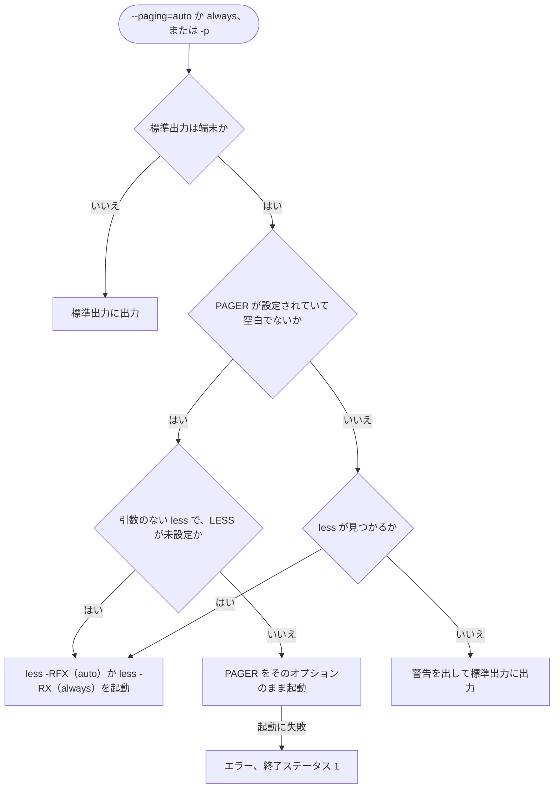
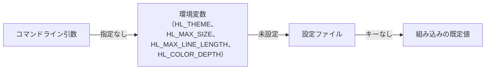
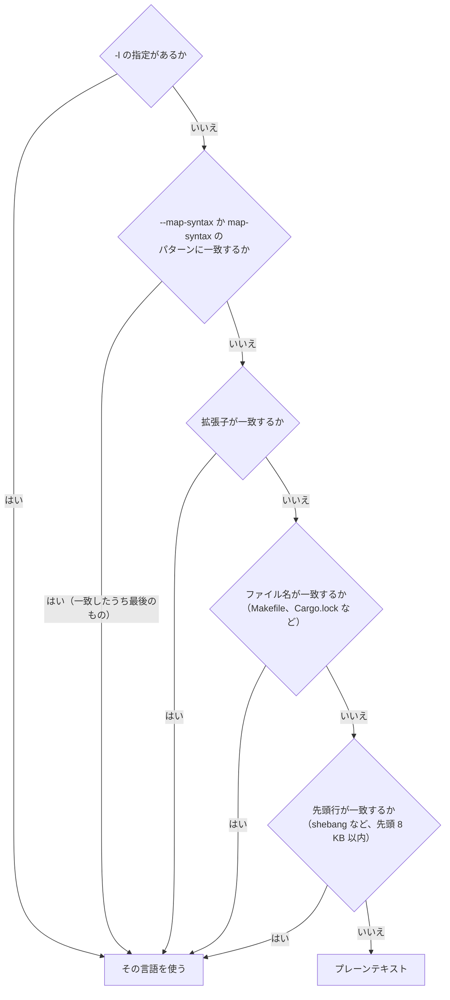
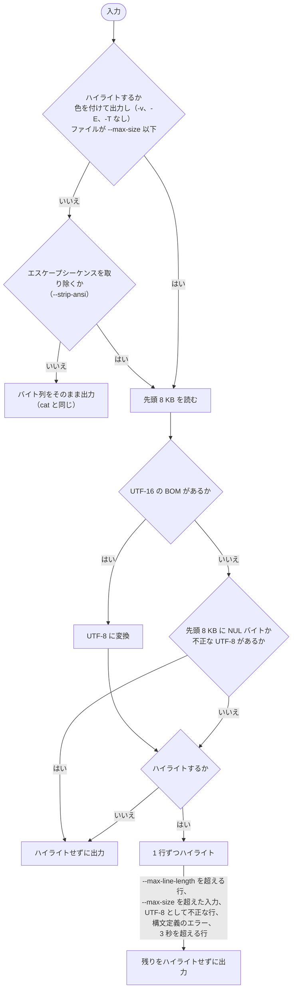

# hl の仕様

[English](SPEC.md) | [日本語](SPEC_ja.md) · [README](../README_ja.md)

このドキュメントでは、`hl` の動作として、オプション、環境変数、設定ファイル、ユーザー定義の構文とテーマ、入力の扱い方を説明します。インストール方法と簡単な使い方は [README](../README_ja.md) を参照してください。

## オプション

| オプション | 説明 |
| --- | --- |
| `-n`, `--number` | 行番号を表示します。`cat -n` と同じく、複数のファイルにまたがって通し番号を振ります |
| `-b`, `--number-nonblank` | 空行以外に行番号を振ります。`-n` より優先されます |
| `-s`, `--squeeze-blank` | 連続する空行を 1 行にまとめます |
| `-r`, `--line-range <N:M>` | 各入力の N 行目から M 行目だけを表示します。`N:` は末尾まで、`:M` は 1 行目から、`N` はその 1 行だけです。行番号は 1 から始まり、数字だけで書きます（`+3` や ` 3` はエラーです） |
| `-H`, `--highlight-line <N:M>` | 各入力の N 行目から M 行目を、テーマの行強調色を背景にして表示します。書式は `-r` と同じで、複数回指定できます。`-n` や `-b` の行番号も一緒に色が付きますが、テキストより右側は塗りません。色を付けて出力するときだけ効くので、色なしの出力は変わりません |
| `--header` | 各入力の前に `==> FILE <==` というヘッダを表示します |
| `--no-number`、`--no-number-nonblank`、`--no-squeeze-blank`、`--no-header` | [設定ファイル](#設定ファイル)でオンにした `-n`、`-b`、`-s`、`--header` をオフにします。フラグと対応する `--no-*` を両方指定したときは、後に書いたほうが効きます |
| `-v`, `--show-nonprinting` | 制御文字と 128 以上のバイトを `^` と `M-` の表記で表示します（改行とタブは除く） |
| `-E`, `--show-ends` | 各行の末尾に `$` を表示します |
| `-T`, `--show-tabs` | タブを `^I` と表示します |
| `-A`, `--show-all` | `-vET` と同じです |
| `-e` | `-vE` と同じです |
| `-t` | `-vT` と同じです |
| `-u` | `cat` との互換のために受け付けますが、何もしません |
| `-l`, `--language <LANG>` | 自動判定を使わずに言語を指定します。言語名か拡張子で指定できます（例: `rust`、`py`） |
| `--map-syntax <PATTERN:LANG>` | グロブパターン PATTERN に合うファイルを言語 LANG で表示します（例: `'*.conf:INI'`）。LANG は `-l` と同じく言語名か拡張子で指定します。`/` を含まないパターンはファイル名と、`/` を含むパターンは絶対パスと照合します（`*` は 1 つのディレクトリの中だけ、`**` は任意の深さのディレクトリに合います）。Windows では、パターンでもパスでも `\` も区切りとして扱うので、`**\conf\*.cfg:INI`、`**/conf/*.cfg:INI`、`C:/proj/*.cfg:INI` のどれも使えます。何度でも指定でき、複数の対応付けが合うときは最後に指定したものを使います。標準入力には適用しません |
| `--theme <THEME>` | テーマを指定します（大文字・小文字は区別しません）。組み込みのテーマとユーザー定義のテーマが使えます。既定は `base16-ocean.dark` です。見つからないテーマ名を指定した場合は警告を出し、既定のテーマで表示します |
| `--max-size <SIZE>` | これより大きい入力はハイライトせずに出力します。既定は `512K` です。0 以上の整数のバイト数で、後ろに `K`、`M`、`G`（1024 倍。大文字でも小文字でも可）の単位を付けられます（`1048576`、`1M` など）。負の数や `1.5K` のような小数は使えません。`0` で上限をなくします |
| `--max-line-length <LEN>` | これより長い行（改行を除いたバイト数）が出てきたら、その行から先をハイライトせずに出力します。既定は `16K` です。書き方は `--max-size` と同じです。`0` で上限をなくします |
| `--paging <WHEN>` | ページャを使うかどうか。`auto`、`always`、`never`（既定）から選びます。`auto` では、出力が 1 画面に収まらないときだけページャで表示します。ページャは `$PAGER`、未設定なら `less -RFX`（`auto`）か `less -RX`（`always`）です。`$PAGER` はシェルと同じ規則で単語に分けるので、クォートが使えます（`PAGER="less -R -S"`、`PAGER="'/opt/my pager/pg'"`）。`$PAGER` が引数のない `less` なら、`LESS` が未設定のときに限り同じ `-RFX` か `-RX` を補います。それ以外は `$PAGER` と `LESS` のオプションをそのまま使うので、色を表示するには `-R` を含めてください。Windows では、`$PAGER` を空白で区切り、ダブルクォートで囲んだ部分はまとめ、バックスラッシュはそのまま残します（`PAGER='"C:\Program Files\Git\usr\bin\less.exe" -R'`）。引数のない `less.exe` にも `less` と同じフラグを補います。`$PAGER` が未設定か空白だけで `less` が見つからないときは、警告（`hl: less not found, printing without a pager (set PAGER to choose one)`）を出して標準出力に表示します。`$PAGER` に指定したページャが起動できないときはエラーです。標準出力が端末でなければページャは起動しません |
| `-p` | `--paging=always` と同じ |
| `--color <WHEN>` | 色を付ける条件を `auto`、`always`、`never` から選びます。既定の `auto` では、出力先が端末のときだけ色を付けます |
| `--color-depth <DEPTH>` | 色深度を `auto`、`truecolor`（別名 `24bit`）、`256` から選びます。既定の `auto` では、`COLORTERM` が `truecolor` か `24bit` のとき、`TERM` が `-direct` で終わるとき、`WT_SESSION` が設定されているとき（Windows Terminal）に 24bit カラーを使い、それ以外では 256 色に近い色に置き換えて表示します。`COLORTERM` は大文字小文字を区別せずに比べますが、空白は取り除きません（`truecolor ` は該当しません）。`-direct` は terminfo の名前と同じく大文字小文字を区別します（`xterm-DIRECT` は該当しません） |
| `--strip-ansi <WHEN>` | 入力に含まれるエスケープシーケンス（色、ウィンドウタイトル、ハイパーリンクなど）を取り除く条件を `auto`、`always`、`never` から選びます。既定の `auto` では、色を付けて出力するときだけ取り除きます。`always` は色を付けないときも取り除き、`never` はそのまま出力します（[動作の詳細](#動作の詳細)を参照） |
| `--list-themes` | 使えるテーマを一覧表示します |
| `--list-languages` | 対応している言語を一覧表示します |
| `--build-cache` | ユーザー定義の構文（後述）をキャッシュして、速く読めるようにします |
| `--clear-cache` | `--build-cache` で作ったキャッシュを消します |
| `--completions <SHELL>` | `bash`、`zsh`、`fish`、`elvish`、`powershell` の補完スクリプトを出力します（[シェル補完と man ページ](../README_ja.md#シェル補完と-man-ページ)を参照） |
| `--man` | man ページを roff 形式で出力します |

ファイルを指定しないか `-` を指定すると、標準入力から読み込みます。

`--paging` と `-p` が出力先を決める流れは次のとおりです。



既定の `--paging=never` では、常に標準出力に出力します。

## 環境変数

| 変数 | 説明 |
| --- | --- |
| `HL_THEME` | 既定のテーマ。`--theme` を指定した場合はそちらが優先されます |
| `HL_MAX_SIZE` | `--max-size` の既定値 |
| `HL_MAX_LINE_LENGTH` | `--max-line-length` の既定値 |
| `HL_COLOR_DEPTH` | `--color-depth` の既定値 |
| `HL_CONFIG` | 設定ファイルの場所 |
| `PAGER` | `--paging` と `-p` で使うページャ |
| `APPDATA`、`LOCALAPPDATA` | Windows だけ。`XDG_CONFIG_HOME` / `XDG_CACHE_HOME` が未設定のとき、設定ディレクトリを `%APPDATA%\hl`、キャッシュディレクトリを `%LOCALAPPDATA%\hl` にします（[設定ファイル](#設定ファイル)を参照） |
| `LESS` | `less` のオプション。設定されていれば、`$PAGER` が引数のない `less` でもオプションを補いません |

`HL_MAX_SIZE`、`HL_MAX_LINE_LENGTH`、`HL_COLOR_DEPTH` の値が不正なときは、コマンドラインと同じくエラーになります。`error: invalid value 'abc' for HL_MAX_SIZE: ...` のように変数名を含むメッセージを表示し、何も出力せずに終了コード 2 で終了します。不正な値を警告して読み飛ばす設定ファイルとは扱いが違います。コマンドラインでオプションを指定すれば環境変数の値は使わないので、その値は検査しません。`HL_THEME` のテーマが見つからないときは、`--theme` と同じく警告を出して既定のテーマを使います。

## 設定ファイル

一部のオプションの既定値は `$XDG_CONFIG_HOME/hl/config.toml`（`XDG_CONFIG_HOME` が未設定か絶対パスでなければ `~/.config/hl/config.toml`）で設定できます。Windows では、この 2 つの間に `%APPDATA%\hl\config.toml`（`C:\Users\<ユーザー名>\AppData\Roaming\hl\config.toml` など）が入ります。`XDG_CONFIG_HOME` が未設定ならこれを使い、`APPDATA` も未設定のときだけ `~/.config` を使います。別のファイルを使うときは `HL_CONFIG` で場所を指定します。キーにはオプションの長い名前を使います。

```toml
theme = "Monokai Extended"
color = "auto"            # auto, always, never
color-depth = "truecolor" # auto, truecolor, 256
strip-ansi = "auto"       # auto, always, never
paging = "auto"           # auto, always, never
max-size = "1M"           # 0 のような整数も書けます
max-line-length = "16K"
number = true             # number-nonblank、squeeze-blank、header も同様
map-syntax = ["*.conf:INI", "Jenkinsfile:Groovy"]
```

優先順位は高い順に、コマンドライン引数、環境変数、設定ファイル、組み込みの既定値です。`hl --help` には設定ファイルを反映した既定値が出ます。設定ファイルがなければ今までどおり動きます。ファイルが読めないときや TOML として正しくないときは、警告を出してファイル全体を無視します。知らないキーや不正な値は、警告を出してその項目だけ読み飛ばします。フラグの `number`、`number-nonblank`、`squeeze-blank`、`header` には `true` か `false` を書きます。ここでオンにしたフラグは、`--no-number`、`--no-number-nonblank`、`--no-squeeze-blank`、`--no-header` でその場だけオフにできます。`-b` が `-n` より優先されるのは、どちらをどこで指定しても同じです。



環境変数のないオプションは、コマンドライン引数の次に設定ファイルを見ます。

`map-syntax` には `--map-syntax` に渡す値を配列で書きます。ほかのキーと違い、コマンドラインで指定すると置き換わる既定値ではありません。`--map-syntax` で指定した対応付けはここに追加され、両方が合うときはコマンドラインのほうを使います。形式が正しくない項目や知らない言語を指定した項目は、警告を出して読み飛ばします。

## ユーザー定義の構文とテーマ

組み込みのものに加えて、設定ディレクトリ（`$XDG_CONFIG_HOME/hl`、`XDG_CONFIG_HOME` が未設定か絶対パスでなければ `~/.config/hl`。Windows では設定ファイルと同じく間に `%APPDATA%\hl` が入ります。`HL_CONFIG` の影響は受けません）に置いた Sublime Text の構文と TextMate のテーマも使えます。

```text
~/.config/hl/
├── syntaxes/   # *.sublime-syntax
└── themes/     # *.tmTheme
```

- ユーザー定義の構文は組み込みのものと同じように使えます。`file_extensions` や `first_line_match` による判定、`-l`、`--map-syntax` のどれでも選べます。組み込みの構文と拡張子が重なったときは、ユーザー定義のほうを使います。
- テーマの名前は拡張子を除いたファイル名です。`themes/My Theme.tmTheme` なら `--theme 'My Theme'` で選びます。組み込みと同じ名前なら、ユーザー定義のほうで置き換わります。
- `--list-languages` と `--list-themes` にはユーザー定義のものも出ます。
- 読み込めないファイルは、警告を出して読み飛ばします。使おうとしたテーマが読み込めないときは `base16-ocean.dark` を使います。

ユーザー定義の構文を組み込みのものとまとめるには数百ミリ秒かかるので、結果をキャッシュしておきます。

```sh
hl --build-cache   # $XDG_CACHE_HOME/hl/syntaxes.bin（未設定か絶対パスでなければ ~/.cache/hl/syntaxes.bin）を作る
                   # Windows では ~/.cache より先に %LOCALAPPDATA%\hl\syntaxes.bin を使う
hl --clear-cache   # キャッシュを消す
```

構文を追加・変更・削除したときや `hl` を更新したときは、もう一度 `hl --build-cache` を実行してください。それまでの間はキャッシュが古いことを `hl` が検出し、毎回その場で構文をまとめたうえで、キャッシュを作り直すよう stderr に表示します。キャッシュのファイルが壊れているときも同じです。テーマは使うときにだけ読むので、キャッシュは要りません。ユーザー定義の構文がなければ、キャッシュは読みませんし、作る必要もありません。

## 動作の詳細

以下の最初のいくつかの項目を図にまとめます。入力の言語は次の順で決まります（標準入力にはパスがないので、使われるのは `-l` と先頭行だけです）。



各入力は次のように出力します。



ハイライトしない出力ではどちらも、指定に応じてエスケープシーケンスを取り除きます（後述）。

- 言語は `-l` の指定、`--map-syntax`（と設定ファイルの `map-syntax`）、拡張子、ファイル名、1 行目（shebang など。先頭 8KB の範囲）の順に判定します。どれでも判定できなければプレーンテキストとして出力します。
- 入力（ファイルや標準入力）の先頭 8KB に NUL バイトが含まれていればバイナリとみなし、ハイライトせずに出力します（後述のエスケープシーケンスを取り除くほかはそのままです）。
- Shift_JIS や EUC-JP など UTF-8 として正しくない入力は、正しくない行から先をハイライトせずにそのまま出力します（先頭 8KB に含まれていればファイル全体。8KB の境目で途中まで入った多バイト文字は正しくないとはみなしません）。バイト列が置き換えられることはありません。ほかの文字コードの自動判定はしません。
- BOM（`FF FE` か `FE FF`）付きの UTF-16 は、色を付けるときやエスケープシーケンスを取り除くときに UTF-8 に変換します。ハイライトするのは、色を付けるときで、かつファイルが `--max-size` 以下のときです。色を付けず、エスケープシーケンスも残すときはそのまま出力します。UTF-8 の BOM は出力に残し、言語の判定では無視します。`-r` では BOM は 1 行目の一部として扱うので、1 行目を表示するときだけ出力します。UTF-32 には対応していません。その BOM（`FF FE 00 00` か `00 00 FE FF`）は UTF-16 とはみなさず、NUL バイトを含むのでバイナリとしてそのまま出力します。
- ハイライトは 1 秒あたり数百 KB しか処理できないため、巨大なファイルや minify された JS / CSS で待たされないように上限を設けています。`--max-size` を超えるファイルは最初からハイライトしません。標準入力のようにサイズがわからない入力は、上限を超えたところから先をハイライトしません。`--max-line-length` を超える行が出てきた場合も、その行から先をハイライトしません。どちらの場合も警告は出さず、`cat` と同じ内容を出力します。
- 1 行のハイライトに 3 秒より長くかかった場合は、警告（`cannot highlight: a line took longer than 3s, printing the rest as plain text`）を出し、その行から先をハイライトせずに出力します。構文定義のエラーで止まったときと同じ扱いです。構文定義によっては、特定の入力でハイライトが終わらなくなることがあるためです。同梱の構文で分かっているものは直してあります（次の項目を参照）。止まったハイライトは専用のスレッドで動いていて途中で止められないので、`hl` が終了するまで CPU を 1 コア使い続けます。ページャで表示している間も同じです。
- 同梱の JavaScript 構文には、bat のものに修正を加えています（HTML、Markdown、Vue、Svelte、QML の中の JavaScript にも使われます）。`x /*` のように式の後にコメントがあると、ハイライトが終わらなくなっていたためです。
- 同梱の Scala 構文にも、bat のものに修正を加えています。`type L = A @> B` や `x: A @< B` のように、型の中で `@` のすぐ後に演算子が続くと、ハイライトが終わらなくなっていたためです。`x: Int @unchecked` のようなアノテーションは、これまでどおりハイライトされます。
- 色を付けて出力するときは、入力に含まれるエスケープシーケンスを取り除きます。ハイライトの色が崩れたり、端末を操作されたり（ウィンドウタイトル、ハイパーリンク、クリップボードなど）しないようにするためです。対象は CSI（`ESC [ ... m` など）、BEL か ST で終わる OSC や DCS などの文字列、そのほか ESC で始まるシーケンス、それに UTF-8 で表した C1 制御文字（U+0080–U+009F）です。8 ビットの CSI（U+009B）や OSC（U+009D）は、`ESC [` や `ESC ]` と同じくシーケンスの始まりとして扱います。シーケンスを取り除いた結果、単独の `0xC2` バイトとシーケンスの後ろのバイトが並んで C1 制御文字になる場合も、取り除く対象です。UTF-8 に変換した後の UTF-16 や、ハイライトせずに出力する部分（バイナリ、`--max-size` や `--max-line-length` を超えた部分、UTF-8 として正しくない行から先）も対象です。終端のない文字列はその行の終わりで終わったものとみなし、入力の末尾で途切れたシーケンスは捨てます。色を付けないときは `cat` と同じ出力になります。`--strip-ansi=always` を指定すると色を付けないときも取り除き、`--strip-ansi=never` を指定するとそのまま出力します。復帰（`\r`）は `cat` と同じく残すので、端末上で行を上書きする表示はそのまま起こります。
- ヘッダやメッセージに出すファイル名やテーマ名に制御文字が含まれていれば、`\x1b` のような形で表示します。細工した名前で端末を操作されないようにするためです。
- `-v`、`-E`、`-T`（と `-A`、`-e`、`-t`）を指定するとハイライトせずに出力するので、`cat` と同じ結果になります。ただし `--strip-ansi=always` を一緒に指定すると、エスケープシーケンスを取り除いてから残りを表示します。たとえば `a\x1b[31m\tb` は、`cat -A` では `a^[[31m^Ib$` ですが、`a^Ib$` になります。`-n`、`-b`、`-s` はハイライトと組み合わせて使えます。
- `-n`、`-b`、`-s` は、エスケープシーケンスを取り除いた後の行を見ます。そのため、`\x1b[0m` のようにエスケープシーケンスしかない行は、`-b` と `-s` では空行として扱います。
- `--header` を指定すると、ファイルが 1 つだけのときも含めて、各入力の先頭に `==> FILE <==` の行を出力します（標準入力は `==> standard input <==`）。ファイルとファイルの間には空行を 1 行入れます。色を付けるときはヘッダを太字にします。ヘッダの行には `-n` や `-b` の行番号を振らず、行番号はこれまでどおりファイルをまたいで通しで数えます。開けなかったファイルや、ディレクトリのように読めなかったファイルにはヘッダを出しません。`--header` を指定しなければ、`cat` と同じ出力になります。
- `-r` を指定しても、範囲より前の行は読み込んでハイライトの解析だけ行います。そのため、ファイル全体を表示したときと同じ色で表示されます。範囲の終わりまで来たら、それより先は読みません。範囲は入力ごとに適用します。`-n` や `-b` はその入力での行番号を表示し、範囲外の行（と `-s` でまとめた空行）も数えます。範囲内で改行なしに終わったファイルの後には、次の入力の前に改行を補います。`-r` を指定しなければ、行番号は `cat` と同じくファイルをまたいで通しで数えます。
- 開けないファイルや読めないファイルがあると `hl: <path>: <理由>`（`hl: src: Is a directory` など。Windows でも同じ）を標準エラー出力に表示し、残りのファイルを処理したあと終了コード 1 で終了します。
- `hl file | head` のように出力先が途中で閉じられても、エラーにはせず正常終了します。
- 標準出力が閉じられている（`hl file >&-`。Windows では標準出力のハンドルなしで起動されたとき）、ディスクがいっぱいなどで出力を書き込めないときは、`hl: write error: <理由>` を標準エラー出力に表示し、`cat` と同じく終了コード 1 で終了します。`--list-themes` や `--man` など、何かを表示して終わるコマンドでも同じです。
- 読み手が閉じたパイプなどで標準エラー出力に書き込めないときは、メッセージを捨てます。出力と終了コードは変わりません。
- 終了コードは次のとおりです。0 は成功で、警告を出して代わりの方法で続けたとき（見つからないテーマ、設定ファイルの不正な項目、ハイライトに時間がかかりすぎた行）も含みます。1 は実行中の失敗です（開けないファイルや読めないファイル、`-l` や `--map-syntax` に指定した未知の言語、書き込みエラー、`$PAGER` に指定したページャの起動失敗）。2 は、実行を始める前にコマンドラインや、オプションの代わりになる環境変数を受け付けなかったときです（未知のオプション、`--max-size=1.5K` や `--color=sometimes` のような不正な値）。
